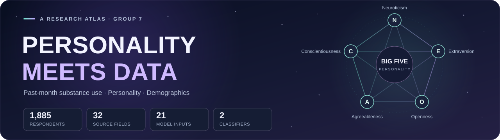
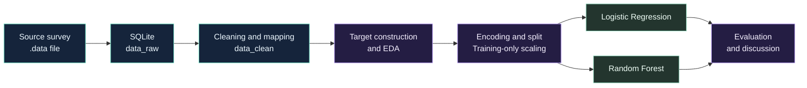
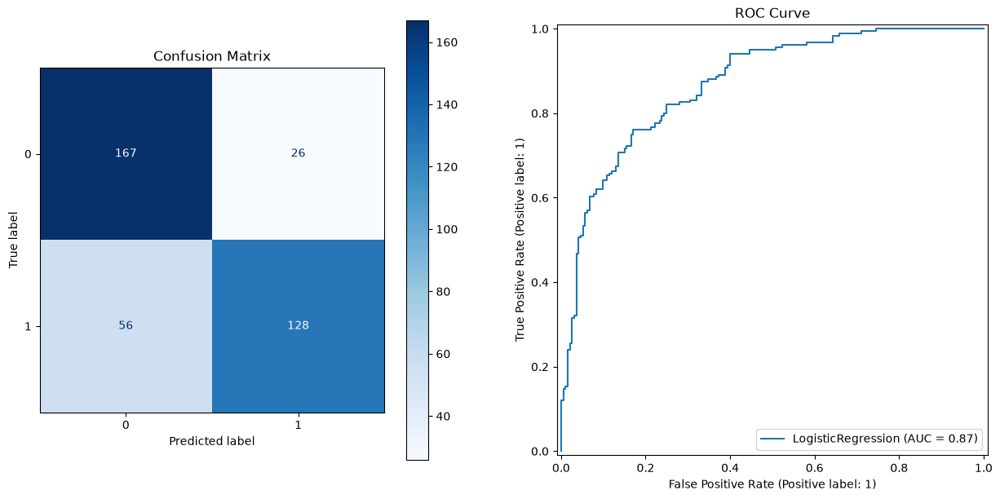
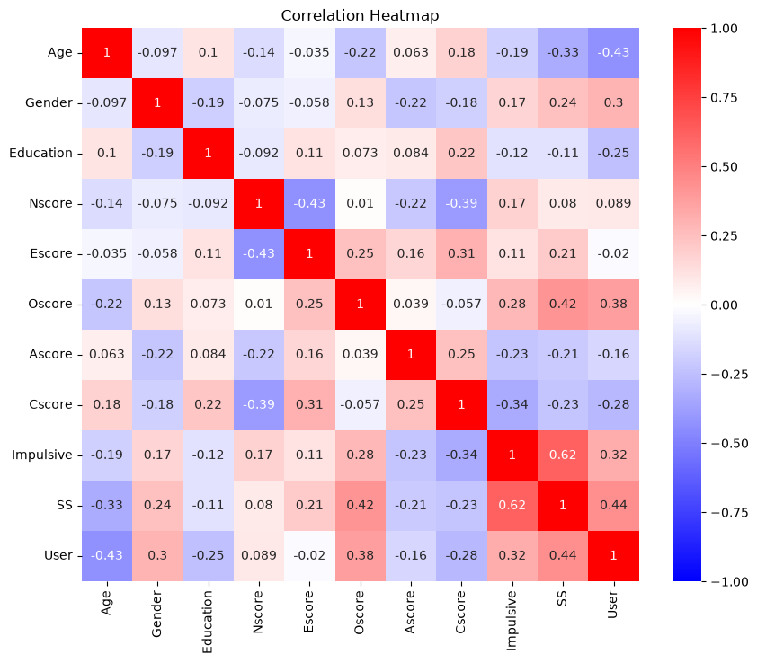

<p align="center">
  
</p>

<h1 align="center">Classifying Past-Month Substance Use<br>Using Personality and Demographic Features</h1>

<p align="center">
  A seven-stage exploration of survey data, personality traits, and self-reported substance use.
</p>

<p align="center">
  
  
  
  
</p>

<p align="center">
  <strong>ADY201m</strong> · AI, Data Science with Python &amp; SQL · <strong>AI2104</strong> · <strong>Group 7</strong>
</p>

<p align="center">
  <a href="Final_Report.ipynb"><strong>Explore the notebook</strong></a> ·
  <a href="#results">Results</a> ·
  <a href="#quick-start">Quick start</a> ·
  <a href="https://archive.ics.uci.edu/dataset/373/drug-consumption-quantified">Dataset</a>
</p>

---

## 🧭 The Research Question

**Can personality scores and demographic characteristics help classify recent substance use within this survey sample?**

We explore the Big Five personality traits, impulsivity, sensation seeking, and demographic variables using Python and SQLite. The project brings data inspection, SQL cleaning, exploratory analysis, feature preparation, and two classification baselines together in [one final report](Final_Report.ipynb).

> **What the target means:** `User = 1` indicates reported use of at least one of eight selected substances during the month before the survey. The analysis classifies reported past behavior; it does not predict future use or diagnose dependence.

| Respondents | Original fields | Model inputs after encoding | Baseline models |
| :---: | :---: | :---: | :---: |
| **1,885** | **32** | **21** | **2** |

## 🗺️ Dataset Atlas

The project uses the [UCI Drug Consumption (Quantified) dataset](https://archive.ics.uci.edu/dataset/373/drug-consumption-quantified). Its demographic variables and questionnaire scores already have numeric representations supplied by the dataset creators.

| Feature group | Variables | Role |
| --- | --- | --- |
| Demographics | `Age`, `Gender`, `Education` | Model inputs |
| Big Five personality | `Nscore`, `Escore`, `Oscore`, `Ascore`, `Cscore` | Model inputs |
| Behavioral scores | `Impulsive`, `SS` | Model inputs |
| Additional demographics | `Country`, `Ethnicity` | Explored during EDA; excluded from model inputs |
| Substance-use responses | Eight selected recency fields | Define the target |
| Record reference | `ID` | Used for identification; excluded from model inputs |

### Eight Selected Substance Fields

`Amphet` · `Cannabis` · `Coke` · `Ketamine` · `LSD` · `Mushrooms` · `Legalh` · `Ecstasy`

| Original response | Reported recency | Binary indicator |
| --- | --- | :---: |
| `CL0`–`CL3` | Never used, or last used more than a month ago | **0** |
| `CL4`–`CL6` | Used within the last month, week, or day | **1** |

The target is positive when **any** of the eight indicators equals 1.

| Target class | Records | Share |
| --- | ---: | ---: |
| **User** | 921 | 48.86% |
| **Non-User** | 964 | 51.14% |

“Non-User” describes the selected substances and time window. It does not mean lifetime abstinence.

## ✨ The Analysis Journey



| Stage | Chapter | What happens |
| :---: | --- | --- |
| **01** | Business Understanding | Define the question, scope, target, and evaluation criteria. |
| **02** | Dataset and Initial Inspection | Define columns, load the `.data` file, select fields, and import them into SQLite. |
| **03** | Data Cleaning | Check duplicates and missing values, inspect unique values, map categories, cast datatypes, and detect outliers. |
| **04** | Target Construction and EDA | Build `User`; explore distributions, correlations, and combinations of demographic and behavioral features. |
| **05** | Data Preparation | Encode age and education, create a stratified 80/20 split, and fit scaling on training data. |
| **06** | Baseline Model Training and Evaluation | Compare Logistic Regression and Random Forest using classification metrics, confusion matrices, and ROC curves. |
| **07** | Discussion and Conclusions | Interpret findings, describe limitations, and identify future improvements. |

**Training set:** 1,508 records · **Test set:** 377 records · **Split seed:** `42`

<a id="results"></a>

## 📊 Results

The latest saved training output in [Final_Report.ipynb](Final_Report.ipynb) reports:

| Model | Accuracy | Precision | Recall | F1 | ROC-AUC |
| --- | ---: | ---: | ---: | ---: | ---: |
| **Logistic Regression** | **78.25%** | **0.8312** | **0.6957** | **0.7574** | **0.8707** |
| Random Forest | 76.66% | 0.8077 | 0.6848 | 0.7412 | 0.8538 |

Precision, recall, and F1 refer to **`User = 1`**. Logistic Regression leads this comparison, while recall indicates that a substantial share of positive cases is missed.

These are **preliminary baseline results**. The same test set is used to compare and select models; cross-validation and independent final evaluation remain future work.

### Classification in View



### Relationships in the Data



The heatmap describes associations within the sample. Correlation alone does not establish causation or a feature’s importance in a fitted model.

<a id="quick-start"></a>

## ⚙️ Quick Start

Use **Python 3.11** and run commands from the repository root.

### 1. Get the Project

```powershell
git clone https://github.com/VicePlr/The-Five-Factor-Model-of-personality-and-evaluation-of-drug-consumption-risk.git
cd The-Five-Factor-Model-of-personality-and-evaluation-of-drug-consumption-risk
```

### 2. Create the Environment and Open JupyterLab

```powershell
python -m venv .venv
.\.venv\Scripts\python.exe -m pip install -r requirements.txt jupyterlab
.\.venv\Scripts\python.exe -m jupyterlab Final_Report.ipynb
```

### 3. Run the Report

Select the project environment, restart the kernel, and run the notebook from top to bottom. In VS Code, open [Final_Report.ipynb](Final_Report.ipynb), select the `.venv` Python kernel, and use **Restart Kernel and Run All Cells**.

The import cells rebuild the SQLite tables. The source survey remains in [`data/drug_consumption.data`](data/drug_consumption.data). SQLite support is included with Python, so a separate database server is not required.

## 📂 Repository Map

```text
.
├── Final_Report.ipynb
├── README.md
├── requirements.txt
├── database.sqlite3
├── data/
│   └── drug_consumption.data
└── assets/
    └── readme/
        ├── banner.svg
        ├── model-evaluation.png
        └── correlation-heatmap.png
```

| Artifact | Purpose |
| --- | --- |
| [Final_Report.ipynb](Final_Report.ipynb) | Complete seven-chapter analysis and presentation notebook. |
| [Source survey](data/drug_consumption.data) | Original comma-separated `.data` file with 1,885 records and 32 fields. |
| [SQLite database](database.sqlite3) | Working storage for `data_raw` and `data_clean`. |
| [Dependencies](requirements.txt) | NumPy, pandas, Matplotlib, seaborn, and scikit-learn. |

## 🔭 Research Notes

- The survey is self-reported and observational. Findings describe associations within this sample.
- UK and USA respondents account for 84.93% of the sample; 91.25% of respondents are recorded as White. Generalization to other populations requires further evaluation.
- Section 3.5 detects IQR outliers and retains the original scores. Any future clipping thresholds should be fitted within training data or training folds.
- Eight source records report using the fictitious substance Semeron. A sensitivity analysis of these records remains an improvement to investigate.
- The repository currently contains notebook-based analysis, rather than a deployed application or saved inference pipeline.

### Next Steps

- [ ] Stratified cross-validation and hyperparameter tuning.
- [ ] Classification-threshold selection using validation data.
- [ ] Sensitivity analysis for survey-validity flags and outlier handling.
- [ ] Export the fitted preprocessing and selected model together.
- [ ] Build a Streamlit demonstration for research and presentation.

## 👥 The Team

| Member | Student ID |
| --- | --- |
| Hoàng Trọng Hiếu | HE211206 |
| Nguyễn Quang Minh | HE211213 |
| Nguyễn Thái Bình Dương | HE211161 |
| Ngô Anh Duy | HE211165 |

## 📜 Dataset Attribution

Fehrman, E., Egan, V., & Mirkes, E. (2015). *Drug Consumption (Quantified)*. UCI Machine Learning Repository. [DOI: 10.24432/C5TC7S](https://doi.org/10.24432/C5TC7S).

The source dataset is available under [CC BY 4.0](https://creativecommons.org/licenses/by/4.0/). Additional background is available in [The Five Factor Model of Personality and Evaluation of Drug Consumption Risk](https://arxiv.org/abs/1506.06297).

---

<p align="center"><strong>ADY201m · AI2104 · Group 7</strong><br>Personality, data, and a carefully defined research question.</p>
